# CariPasal

CariPasal adalah aplikasi untuk mencari dan membaca pasal hukum Indonesia. Saat ini isinya KUHP
nasional (UU 1/2023, sudah termasuk perubahan UU 1/2026), KUHAP baru (UU 20/2025), KUHPerdata
(Burgerlijk Wetboek, terjemahan tidak resmi), dan UU ITE (UU 11/2008 beserta perubahannya).
Admin mengelola dan memverifikasi teks lewat dashboard web. Pengguna membaca pasal lewat aplikasi
mobile yang tetap bisa dipakai tanpa internet setelah data diunduh.

| Admin dashboard | Aplikasi mobile |
|---|---|
| 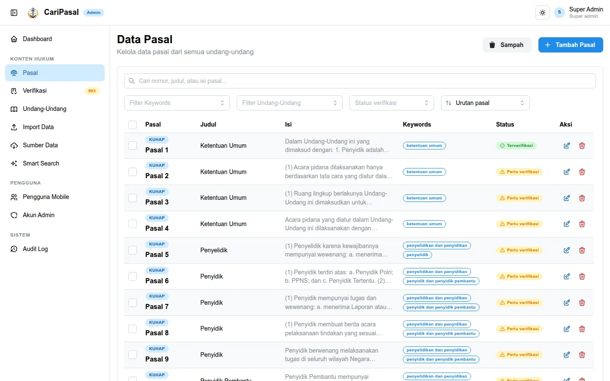 | 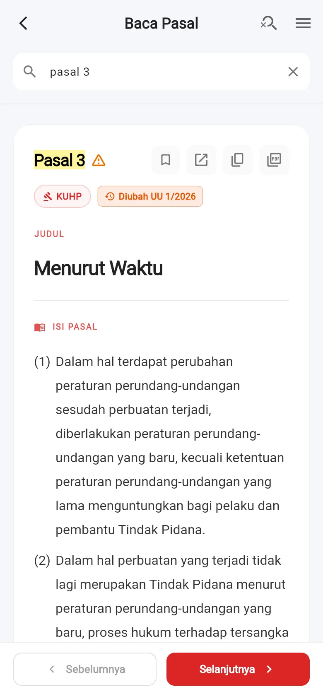 |

Arsitektur production memakai satu subdomain:

```text
https://pasal.kampus.ac.id/admin  -> React admin dashboard
https://pasal.kampus.ac.id/api    -> Laravel REST API
https://pasal.kampus.ac.id/mobile -> Flutter Web mobile
```

## Daftar isi

- [Stack](#stack)
- [Struktur folder](#struktur-folder)
- [Fitur](#fitur)
- [Alur data hukum](#alur-data-hukum)
- [Development dengan Docker](#development-dengan-docker)
- [Alternatif non-Docker](#alternatif-non-docker)
- [Menyiapkan data hukum](#menyiapkan-data-hukum)
- [Verifikasi kode](#verifikasi-kode)
- [Deploy aaPanel](#deploy-aapanel)
- [Dokumentasi teknis](#dokumentasi-teknis)

## Stack

| Bagian | Teknologi |
|---|---|
| Backend | Laravel 13 (PHP 8.3), PostgreSQL 16, Sanctum, antrean database |
| Admin | React 19, Mantine 9, React Query, Vite 7, TypeScript |
| Mobile | Flutter 3.47 dengan `material_ui`, Drift (SQLite) untuk data offline, `url_launcher` |
| Pipeline data | Python 3 (`pymupdf`, `beautifulsoup4`, `openpyxl`) di `import-tools/` |
| Lokal | Docker Compose |
| Production | aaPanel, Nginx, PHP-FPM |

## Struktur folder

```text
projek-pasal/
  backend-laravel/      Laravel REST API
  admin-dashboard/      React admin dashboard
  pasal_mobile_app/     Flutter mobile app (Android, iOS, web)
  import-tools/         Pipeline Python: datahukum.com + PDF BPK -> file import
  data-import/          Hasil pipeline yang siap diimport (xlsx + README per UU)
  mobile-web-dist/      Hasil build Flutter Web yang dipublish ke server
  deploy/               Script dan konfigurasi aaPanel
  docs/                 Dokumentasi teknis dan screenshot
```

## Fitur

### Data hukum

- **KUHP 2023**: 625 pasal, sudah dikonsolidasi dengan UU 1/2026 tentang Penyesuaian Pidana. 52
  pasal diubah, Pasal 599A disisipkan, dan Pasal 615 serta 616 tercatat "Dihapus.".
- **KUHAP 2025**: 369 pasal.
- **KUHPerdata**: 2124 pasal (1993 pasal asli dan pasal sisipan seperti 1601a). Teksnya terjemahan
  tidak resmi dari Burgerlijk Wetboek berbahasa Belanda, jadi admin mencocokkannya lewat antrean
  verifikasi. Perubahan oleh 47 Staatsblad (1872-1939) dan UU 23/2006 tersimpan sebagai riwayat; 64
  pasal tercatat "Dicabut.". Bab yang tidak berlaku lagi karena UU Perkawinan, UUPA, UU Hak Tanggungan,
  atau dianggap tidak berlaku oleh SEMA 3/1963 diberi baris "Catatan CariPasal:" di penjelasan.
- **UU ITE**: 63 pasal, dikonsolidasi dengan UU 19/2016, UU 1/2024, dan UU 1/2026. Pasal 30, 36, 46,
  dan 47 serta beberapa ayat Pasal 27, 28, 31, 45, 45A, dan 51 tercatat "Dicabut."; ancaman denda
  Pasal 45, 45A, 45B, dan 48-51 memakai kategori sesuai lampiran UU 1/2026. Putusan MK 20/PUU-XIV/2016,
  105/PUU-XXII/2024, dan 115/PUU-XXII/2024 dicatat di penjelasan pasal terkait.
- Teks diambil dari datahukum.com (bukan sumber resmi). Untuk KUHP, KUHAP, dan UU ITE, pipeline
  membandingkannya dengan PDF resmi JDIH BPK dan mencatat koreksi typo per pasal. KUHPerdata tidak punya
  naskah resmi berbahasa Indonesia, jadi teksnya dipindai untuk sisa teks penerjemah dan kata asing.
- Setiap pasal menyimpan judul bagian/paragraf (`judul`) dan bab tempatnya (`bab`, contoh
  "Buku Kedua · Bab XXIII · Tindak Pidana Pencurian"), keduanya diisi otomatis dari struktur naskah.
  Pasal terkait otomatis diambil dari rujukan di isi pasal ("sebagaimana dimaksud dalam Pasal 66 ayat (1)").

### Admin dashboard

- **Verifikasi**: setiap pasal hasil import berstatus *Perlu verifikasi* sampai admin mencocokkannya
  dengan naskah resmi. Antrean verifikasi menampilkan progres per undang-undang, dan untuk pasal yang
  diubah, link naskahnya mengarah ke UU pengubahnya.
- **Riwayat perubahan**: setiap versi rumusan pasal (asli, diubah, disisipkan, dihapus) beserta
  tanggal dan link naskah resminya. Perubahan antarversi ditandai per kata. Admin juga bisa menambah
  atau mengoreksi versi secara manual.
- **Sumber Data**: memeriksa pembaruan dari datahukum.com kapan saja. Hasilnya berupa draft yang
  dibandingkan 3 arah (sumber lama, data sekarang, sumber baru). Tidak ada yang berubah sebelum admin
  menekan Terapkan, dan pasal yang diedit admin tidak tertimpa diam-diam.
- Import Excel dan foto halaman buku (OCR), trash/restore, pasal terkait, Smart Search (alias
  istilah sehari-hari), kelola pengguna mobile dan admin, audit log.
- Tema terang, gelap, atau ikuti sistem. Pesan validasi backend berbahasa Indonesia.

| | |
|---|---|
| 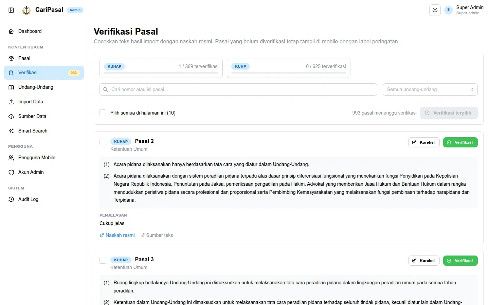 | 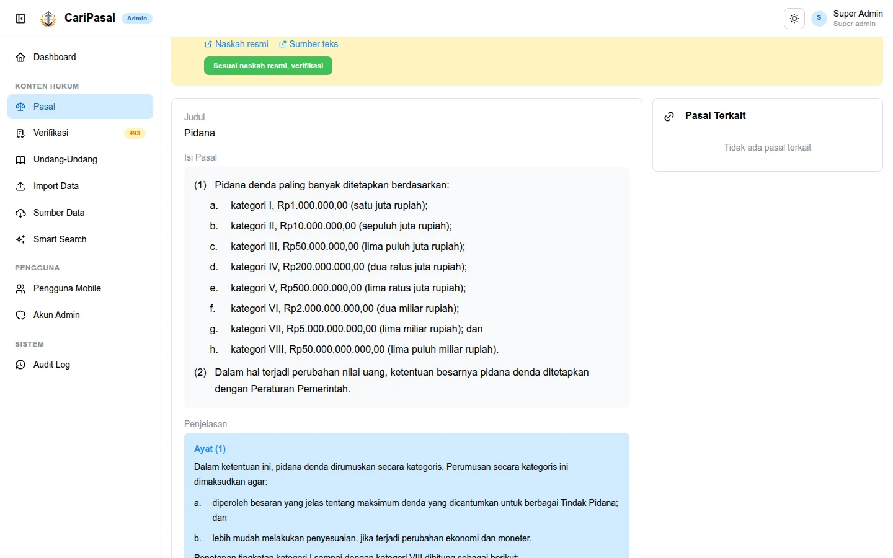 |
| 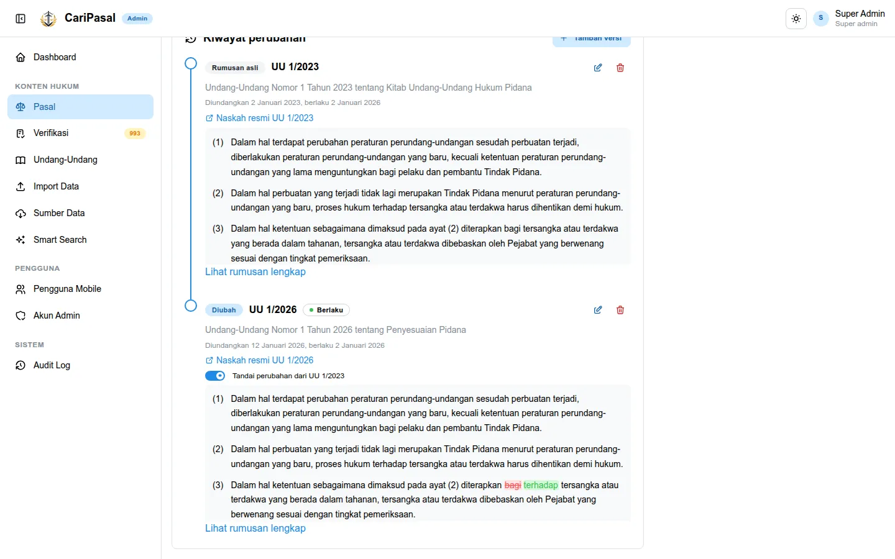 | 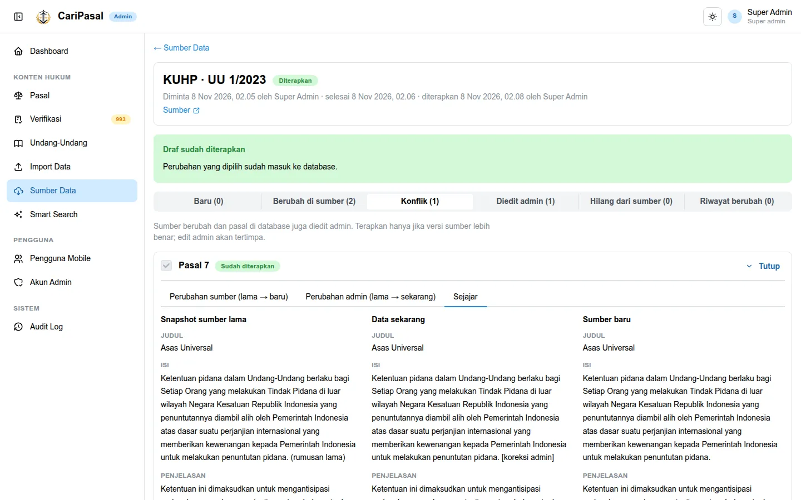 |
| 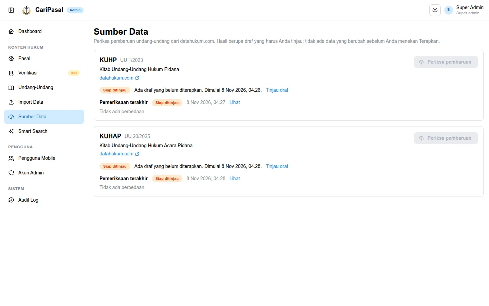 | 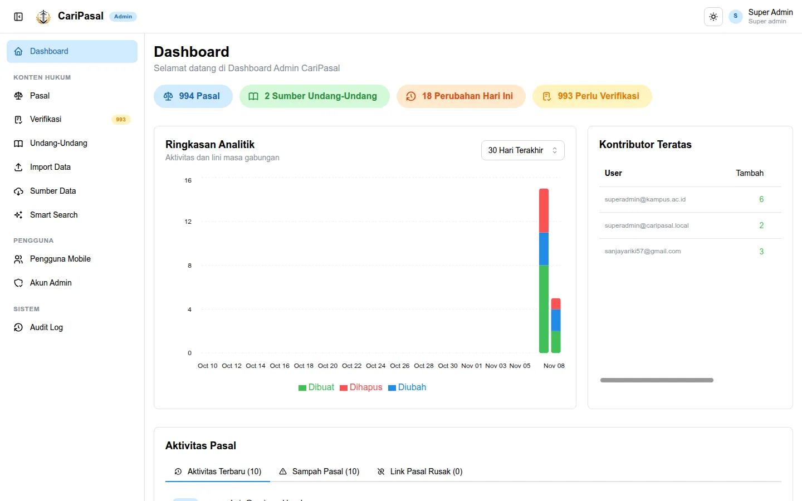 |

### Aplikasi mobile

- Data diunduh sekali, lalu bisa dibaca tanpa internet. Setiap kali dibuka, aplikasi memeriksa
  pembaruan dan hanya mengunduh yang berubah.
- Pencarian nomor, judul, dan isi pasal, filter per undang-undang dan per bab (lalu judul di dalam bab),
  serta alias Smart Search dari dashboard. Hasil kueri beberapa kata dikelompokkan: frasa persis, istilah
  terkait, semua kata tidak berurutan, lalu sebagian kata.
- Isi dan penjelasan pasal ditata per ayat dan butir. Pasal yang belum diverifikasi diberi ikon
  peringatan kecil di sebelah judul.
- Pasal yang diubah UU lain diberi label (misalnya "Diubah UU 1/2026") dan punya panel riwayat
  dengan tanda perubahan per kata.
- Tombol "Buka naskah resmi" membuka PDF/halaman JDIH di browser.
- Simpan pasal, ekspor PDF, mode gelap, dan versi web untuk iPhone/Android lewat browser.

| Beranda | Pencarian | Baca pasal | Riwayat perubahan |
|---|---|---|---|
| 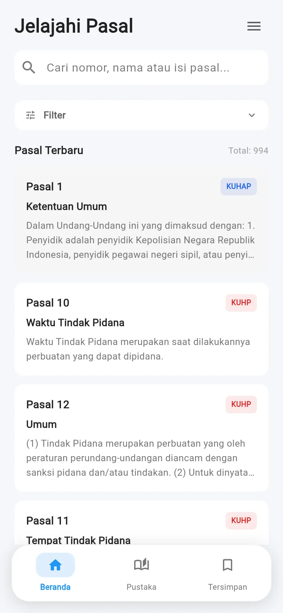 | 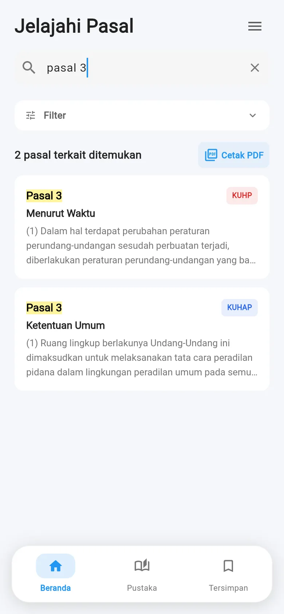 |  | 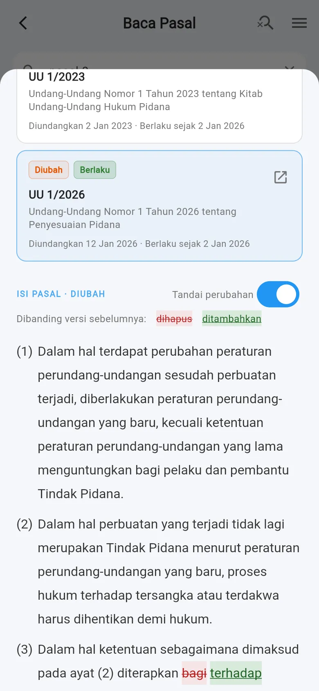 |

### Akses akun mobile

- Login mobile memakai satu form email dan password untuk pengguna, admin, dan super admin. Server menentukan jenis akun dari kredensial yang cocok. Jika email ada di kedua tabel, password yang berbeda tetap mengarah ke akun masing-masing; bila keduanya cocok, akun admin didahulukan. Akun admin yang cocok tetapi nonaktif tetap ditolak, bukan dialihkan ke akun pengguna.
- Lupa password mobile cukup mengirim email. Jika kedua jenis akun aktif memakai email yang sama, server mengirim tautan reset terpisah untuk masing-masing jenis akun; setiap tautan hanya dapat mereset akun yang dituju.
- Admin dan super admin memakai akun dashboard yang sudah ada, tanpa membuat akun mobile kedua. Akses akun admin tidak kedaluwarsa dan tidak memakai pemeriksaan password tahunan. Akun pengguna biasa tetap mengikuti masa aktif dan pemeriksaan password tahunannya.
- Keduanya memiliki maksimal 3 perangkat mobile aktif. Perangkat admin muncul di **Akun Admin → Perangkat mobile**; tombol **Paksa keluar** mencabut token perangkat tersebut tanpa mengakhiri sesi dashboard. Menonaktifkan akun mencabut semua sesi dan perangkat akun itu.
- Sesi mobile admin tetap hanya mendapat akses pembaca. Token mobile tidak dapat mengakses API dashboard, dan token dashboard tidak dapat dipakai untuk sinkronisasi mobile. Token mobile terikat ke satu ID perangkat.
- Akses offline membutuhkan metadata sesi dari server dan berlaku maksimal 30 hari sejak login atau pemeriksaan `/mobile/me` terakhir yang berhasil, serta tidak melewati masa aktif akun biasa. Setelah batas offline habis, aplikasi terkunci sampai status akun diverifikasi kembali secara online. Pemeriksaan dilakukan saat startup, resume, dan setiap menit selama aplikasi terbuka.
- Pencabutan sesi dikenali saat request online ditolak. Perangkat yang benar-benar offline tidak dapat mengetahui perubahan status server saat itu juga; akses lokalnya berhenti saat batas offline atau masa aktif akun habis. Data hukum yang sudah diunduh tidak dihapus saat logout.

Kontrak autentikasi mobile:

```text
POST /api/mobile/login
  email, password, device_id, device_name?, platform?

Login dan GET /api/mobile/me mengembalikan:
  access.account_type: mobile | admin
  access.expires_at: ISO-8601 | null (admin selalu null)
  access.offline_access_until: ISO-8601
```

Deploy backend dan aplikasi mobile versi ini bersama-sama. Sesi mobile lama tanpa scope perangkat atau metadata akses harus login ulang; flag lokal lama `is_admin` tidak lagi memberi pengecualian. Sesi dashboard lama tetap dapat digunakan.

## Alur data hukum

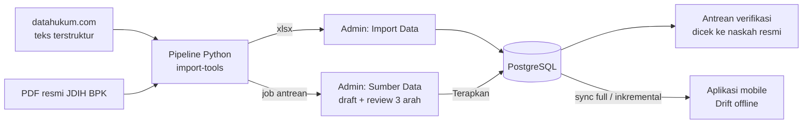

## Development dengan Docker

### Layout env

```text
/.env                               -> hanya untuk Docker Compose (port, nama project)
backend-laravel/.env.docker         -> env backend untuk container Docker
backend-laravel/.env                -> env backend jika jalan manual
admin-dashboard/.env.docker         -> env frontend untuk build Docker
admin-dashboard/.env                -> env frontend jika jalan manual
pasal_mobile_app/.env.docker        -> env Flutter web untuk build Docker
```

### Setup awal

```powershell
copy .env.example .env
copy backend-laravel\.env.docker.example backend-laravel\.env.docker
copy admin-dashboard\.env.docker.example admin-dashboard\.env.docker
copy pasal_mobile_app\.env.docker.example pasal_mobile_app\.env.docker
docker compose up -d --build
```

| Service | Alamat lokal | Keterangan |
|---|---|---|
| `admin-dashboard` | http://127.0.0.1:8080 | Nginx + build React |
| `mobile-web` | http://127.0.0.1:3001 | Nginx + build Flutter Web |
| `backend` | http://127.0.0.1:8000/api | Laravel |
| `queue-worker` | - | Menjalankan job antrean, termasuk pemeriksaan Sumber Data |
| `postgres` | 127.0.0.1:55432 | PostgreSQL 16 |
| `mailpit` | http://127.0.0.1:8025 | Kotak masuk email untuk uji reset password |

Port bisa diubah di `/.env`. Seeder membuat super admin awal:

```text
email:    superadmin@caripasal.local
password: ChangeMe123!
```

Untuk menguji reset password, kirim reset dari halaman login admin lalu buka emailnya di Mailpit.

### Catatan container

- **PHP**: Dockerfile backend memakai `php:8.3.36-cli-alpine3.24` secara default. Untuk memakai base
  image lain (misalnya image lokal yang sudah diverifikasi), set build arg `PHP_BASE_IMAGE`.
- **Nginx**: `admin-dashboard` dan `mobile-web` me-resolve ulang alamat `backend` lewat DNS internal
  Docker (`127.0.0.11`) setiap 5 detik. Tanpa ini, Nginx menyimpan IP lama dan mengembalikan 502
  setiap kali container backend dibuat ulang. Fitur `resolve` butuh Nginx 1.27.3 atau lebih baru.
  Perubahan `nginx.conf` diterapkan dengan `docker compose up -d --build mobile-web admin-dashboard`.
- **Pipeline di image backend**: image backend berisi Python dan `import-tools/` (lewat
  `additional_contexts` di compose). Cache HTML/PDF disimpan di volume `caripasal_import_cache` yang
  hanya dipasang di `queue-worker`.
- **Sumber Data** hanya aktif bila `DATAHUKUM_FETCH_ENABLED=true` di `backend-laravel/.env.docker`.
  Default-nya `false`.
- **Migrasi**: entrypoint menjalankan migrasi dan seeder saat container start
  (`RUN_MIGRATIONS`, `RUN_SEEDERS`). Matikan keduanya bila migrasi ingin dijalankan manual dengan
  `docker exec <backend> php artisan migrate --force`.

## Alternatif non-Docker

Kebutuhan lokal: PHP 8.3+ (extension `pdo_pgsql`, `pgsql`, `fileinfo`, `mbstring`, `openssl`,
`curl`, `zip`, `xml`, `gd`), Composer, Node.js 22+, PostgreSQL native, dan `psql`. Python 3 hanya
dibutuhkan untuk pipeline data.

Di Windows, install PostgreSQL dengan **Command Line Tools**, port `5432`, lalu:

```powershell
.\setup-local-native.ps1            # database, user, env, dependency, migrasi, seeder
.\setup-local-native.ps1 -SkipDatabaseCreate   # jika database dan user sudah dibuat manual
.\start-local-native.ps1            # menjalankan backend dan admin
.\stop-local-lan.ps1                # menghentikan server lokal
```

```text
Admin laptop:        http://127.0.0.1:5173/admin
API health:          http://127.0.0.1:8000/api/health
Admin HP satu Wi-Fi: lihat output script start-local-native.ps1
Android emulator:    http://10.0.2.2:8000/api
```

Menjalankan manual tanpa script:

```powershell
cd backend-laravel
composer install
copy .env.example .env
php artisan key:generate
php artisan migrate --seed
php artisan serve --host=127.0.0.1 --port=8000
php artisan queue:work --queue=imports,default --timeout=900   # terminal lain, untuk Sumber Data

cd admin-dashboard
npm install
npm run dev
```

## Menyiapkan data hukum

Tambah atau edit **Admin > Undang-Undang** untuk menyimpan URL sumber teks, URL PDF asli atau unggahan
PDF maksimal 20 MiB. Link naskah resmi tetap terpisah dari tautan langsung PDF. Sumber otomatis muncul
di **Sumber Data**, termasuk saat pengambilan dinonaktifkan. Menyimpan UU tidak mengunduh sumber,
menjalankan antrean, atau mengubah pasal. UU tanpa sumber tetap dapat diisi manual.

Sumber datahukum baru dengan struktur yang didukung tidak memerlukan file Python per UU. Saat
pemeriksaan, parser mendeteksi versi asli dan identitas perubahan dari metadata HTML, bukan nomor
atau tahun yang ditebak dari judul. Penanda versi asli di form hanya override opsional. Konfigurasi
lengkap berarti pemeriksaan boleh dijalankan, bukan bukti bahwa sumber sudah berhasil diparse.
Badge parsing terpisah memakai hasil pemeriksaan snapshot konfigurasi dan PDF yang sama; mengubah
sumber atau PDF membatalkan bukti lama. Judul umum seperti Amandemen I–IV dipertahankan, tanggal
pengesahan tidak disalin menjadi tanggal pengundangan, dan riwayat ambigu tetap diblokir.

Pipeline ada di `import-tools/` (detail: [import-tools/README.md](import-tools/README.md)). Untuk
ekspor manual dengan snapshot konfigurasi JSON tepercaya:

```bash
python -m venv .venv && .venv/bin/pip install -r import-tools/requirements.txt
.venv/bin/python import-tools/prepare_import.py --config source.json
```

Hasilnya ada di `data-import/<slug>/`:

- `*.xlsx` berisi sheet `import` (pasal, bab, pasal terkait), `review` (cakupan teks terhadap PDF
  BPK atau temuan pemindaian), `riwayat` (semua versi rumusan per peraturan sumber), dan `catatan`.
- `README_IMPORT.md` berisi ringkasan konsolidasi, catatan Putusan MK, dan pasal yang perlu dicek
  manual.

Upload xlsx lewat **Admin > Import Data** setelah memilih undang-undangnya. Sheet `riwayat` ikut
terbaca. Pasal baru atau yang teksnya berubah otomatis masuk antrean verifikasi.

Untuk memperbarui data yang sudah ada, pakai **Admin > Sumber Data > Periksa pembaruan**. Job di
`queue-worker` menjalankan pipeline yang sama, lalu menampilkan perubahan per kategori (baru, berubah
di sumber, konflik, diedit admin, hilang dari sumber, riwayat berubah) untuk ditinjau sebelum
diterapkan. Draf menyimpan snapshot sumber dan PDF yang tidak berubah ketika UU diedit. Hanya item
yang dipilih yang diterapkan; hasil impor tetap perlu verifikasi naskah resmi.

datahukum.com bukan sumber resmi dan izin pemakaian datanya masih diurus (issue #21). Karena itu
fitur Sumber Data mati secara default.

## Verifikasi kode

```bash
# Backend: unit test (sqlite)
cd backend-laravel && php artisan test

# Admin: typecheck + build
cd admin-dashboard && npm run build

# Mobile: analisis dan tes (tes database butuh libsqlite3)
cd pasal_mobile_app && flutter analyze && flutter test
```

Mobile tanpa Flutter di host bisa dites lewat image toolchain:

```bash
docker build --target flutter-sdk -t caripasal-flutter:3.47.9 pasal_mobile_app
docker run --rm -v "$PWD/pasal_mobile_app:/app" -w /app caripasal-flutter:3.47.9 \
  sh -c 'flutter pub get && flutter analyze && flutter test'
```

CI (`.github/workflows/ci.yml`) membangun admin dan mobile web di setiap pull request ke `main`.

## Deploy aaPanel

Update rutin:

```bash
cd /www/wwwroot/pasal
DOMAIN=pasal.kampus.ac.id bash deploy/aapanel-update.sh
```

Cek prasyarat server:

```bash
cd /www/wwwroot/pasal
bash deploy/aapanel-doctor.sh
```

Checklist untuk rilis yang membawa verifikasi, riwayat, Sumber Data, dan KUHPerdata:

1. Backup database.
2. Migrasi (`php artisan migrate --force`) sudah dijalankan oleh `deploy/aapanel-deploy.sh`; cek
   outputnya.
3. Import ulang data KUHP/KUHAP dari `data-import/` lewat Admin > Import Data.
4. KUHPerdata: buat UU kode `KUHPER` di menu Undang-Undang (isiannya ada di
   `data-import/kuhper-1847/README_IMPORT.md`), lalu import xlsx-nya. File ini dikirim
   sebagai satu permintaan sekitar 2,5 MB, jadi `client_max_body_size` Nginx untuk `/api/` minimal
   20m (sudah ada di `deploy/aapanel-nginx.conf`) dan `post_max_size` PHP minimal 8M.
5. Pastikan `APP_LOCALE=id` dan `DATAHUKUM_FETCH_ENABLED=false` di env production.
6. Bila nanti Sumber Data diaktifkan: pasang Python 3 dan venv dari `import-tools/requirements.txt`,
   isi `IMPORT_PYTHON`, `IMPORT_TOOLS_DIR`, `IMPORT_CACHE_DIR`, lalu jalankan
   `php artisan queue:work --queue=imports,default --timeout=900` lewat Supervisor.
7. Build ulang mobile web dan APK dengan Flutter 3.47.9. Perangkat yang sudah punya data akan
   diminta Update sekali supaya riwayat pasal ikut terunduh.

### Deploy mobile web ke `/mobile/`

Mobile web dipakai agar pengguna iPhone/Android bisa membuka aplikasi lewat browser:

```text
https://ubgpasal.ubg.ac.id/mobile/
```

Flutter Web dibuild di laptop (Flutter 3.47.9), lalu hasilnya dipush ke GitHub:

```powershell
.\build-mobile-web.ps1 `
  -ApiBaseUrl "https://ubgpasal.ubg.ac.id/api" `
  -WebAppUrl "https://ubgpasal.ubg.ac.id" `
  -BaseHref "/mobile/"

git add mobile-web-dist build-mobile-web.ps1 deploy/aapanel-publish-mobile-web.sh docs/MOBILE_WEB_AAPANEL.md README.md
git commit -m "build: update mobile web kampus"
git push origin main
```

Publish di server kampus:

```bash
cd /www/wwwroot/hukum-ubg.ac.id/projek-pasal

APP_ROOT=/www/wwwroot/hukum-ubg.ac.id/projek-pasal \
DOMAIN=ubgpasal.ubg.ac.id \
bash deploy/aapanel-mobile-web-update.sh
```

Config Nginx domain `ubgpasal.ubg.ac.id` harus punya blok:

```nginx
location ^~ /mobile/ {
    alias /www/wwwroot/hukum-ubg.ac.id/projek-pasal/mobile/;
    index index.html;
    try_files $uri $uri/ /mobile/index.html;
}
```

### Catatan production

- Jangan commit file env yang berisi credential production.
- Root `.env` hanya untuk Docker Compose, bukan sumber konfigurasi Laravel/frontend production.
- Pastikan `APP_DEBUG=false`.
- PostgreSQL jangan dibuka ke publik.
- Backup database sebelum update besar.
- Jika SMTP Gmail timeout dari aaPanel, gunakan `MAIL_MAILER=resend` karena Resend memakai HTTPS
  port 443.

## Dokumentasi teknis

- [Arsitektur Sistem](docs/ARSITEKTUR.md)
- [Database Schema](docs/DATABASE.md)
- [Pipeline data hukum](import-tools/README.md)
- [Aplikasi mobile](pasal_mobile_app/README.md)
- [Deploy CariPasal di aaPanel](docs/AAPANEL_DEPLOYMENT.md)
- [Deploy Flutter Web Mobile ke aaPanel](docs/MOBILE_WEB_AAPANEL.md)
- [Panduan Admin Kampus untuk Uji Coba Mobile Web](docs/README_ADMIN_KAMPUS_UJI_COBA.md)
- [Smart Search CariPasal](docs/SMART_SEARCH.md)
- [Catatan Migrasi Historis](docs/LARAVEL_POSTGRESQL_MIGRATION_PLAN.md)

## Lisensi

Hak Cipta 2026. Seluruh hak dilindungi.
